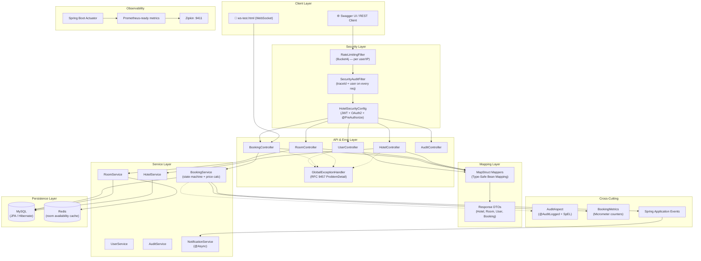
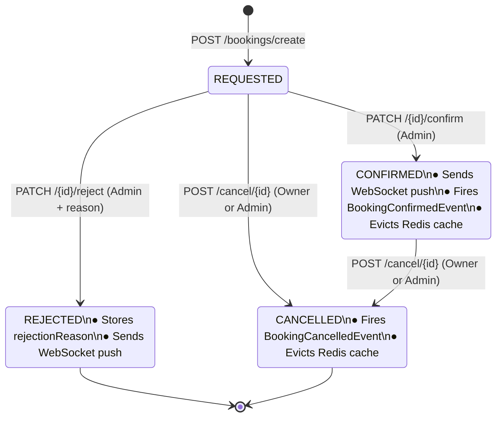
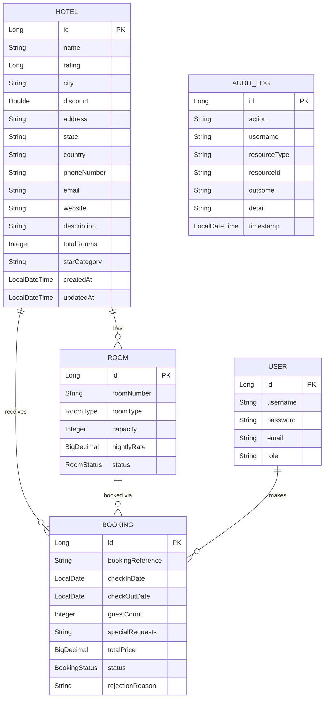
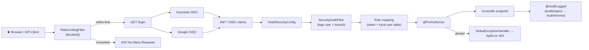
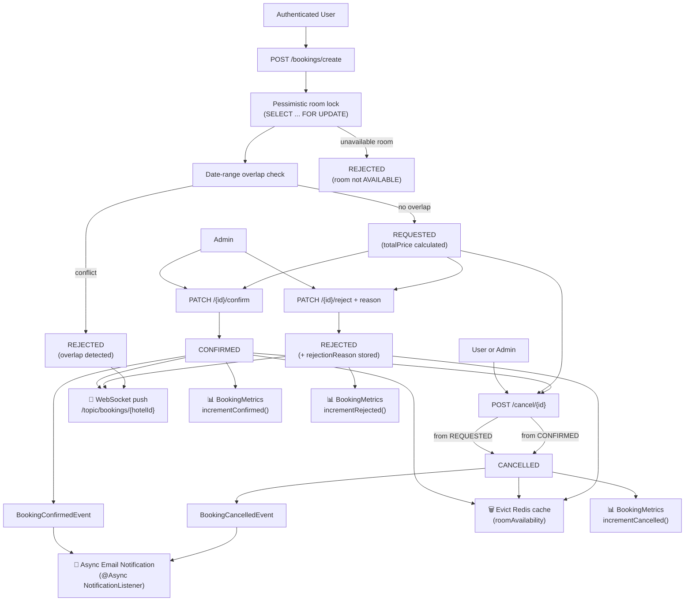
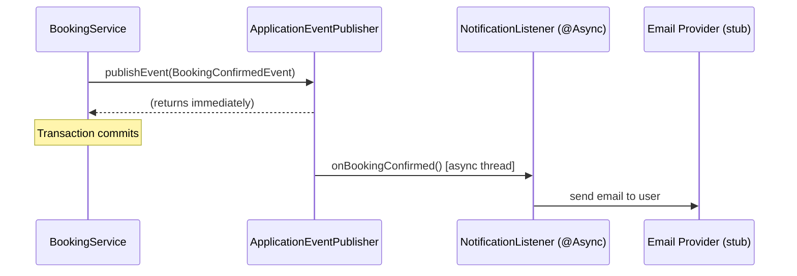
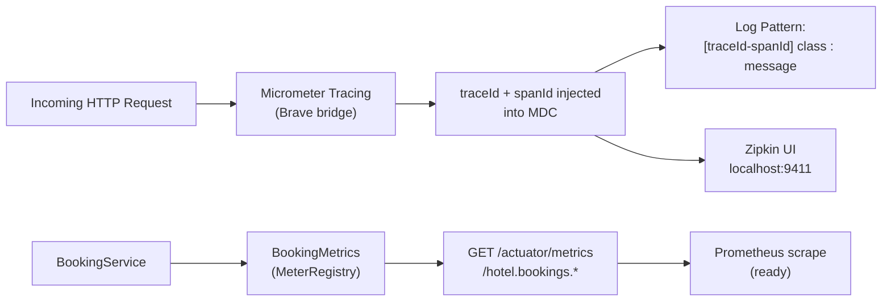
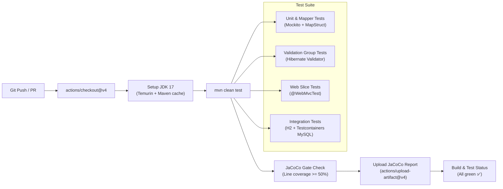
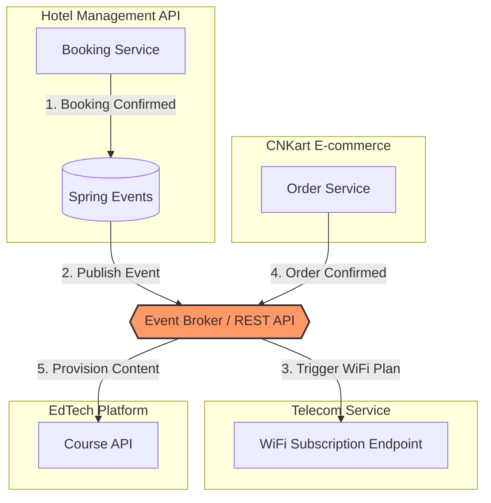

# Hotel Management API


## Live Demo

Live: [https://your-app.railway.app/swagger-ui.html](link goes here after deployment)

Swagger UI is the interactive API demo — no separate frontend needed.

---

A **production-grade Spring Boot REST API** for managing hotels, rooms, and bookings. The application features a rich approval-based booking workflow, JWT/OAuth2 security, Redis caching, rate limiting via Bucket4j, async email notifications, custom Micrometer metrics, AOP-driven audit logging, WebSocket/STOMP push notifications, paginated endpoints, Swagger/OpenAPI 3 docs, distributed tracing via Micrometer/Zipkin, compile-time MapStruct response DTO mapping, RFC 9457 Problem Details error handling, validation groups, and a fully green GitHub Actions CI pipeline with JaCoCo test coverage enforcement backed by Testcontainers MySQL.

---

## What's New — Upgrade Highlights

> These improvements were added across 14 phased commits on top of the original baseline.

| Phase | Feature | Impact |
|-------|---------|--------|
| **1** | Lombok annotations on all entities | Eliminated ~40% of entity boilerplate; added `@Builder`, `@EqualsAndHashCode(of="id")`, safe `@ToString` |
| **2** | Hotel entity enrichment | Added `address`, `state`, `country`, `phoneNumber`, `email`, `website`, `description`, `totalRooms`, `starCategory`, `createdAt`, `updatedAt` with `@PrePersist`/`@PreUpdate` |
| **3** | Booking lifecycle upgrade | 4-state machine (`REQUESTED → CONFIRMED / REJECTED → CANCELLED`), `rejectionReason` field, dedicated confirm/reject PATCH endpoints |
| **4** | Async email notifications | `@Async` `NotificationListener` — decoupled from booking transaction, non-blocking |
| **5** | Bucket4j rate limiting | Per-user/IP limits: 20 bookings/min · 5 registrations/hr · 60 availability searches/min |
| **6** | Pagination everywhere | All list endpoints accept `page`, `size`, `sortBy`, `direction` query params |
| **7** | Custom Micrometer metrics | `BookingMetrics` — counters for created/confirmed/rejected/cancelled; gauge for active bookings |
| **8** | AOP audit logging | `@AuditLogged` annotation + `AuditAspect` with SpEL resource-ID extraction |
| **9** | End-to-end test suite | `EndToEndWorkflowIntegrationTest` covering the full lifecycle on real MySQL via Testcontainers |
| **10** | CI hardening | Fixed H2↔Testcontainers driver clash; all tests green on GitHub Actions |
| **11** | Response DTOs & MapStruct | Eliminated JPA entity leakage, circular JSON dependencies, and password hash exposure across all controllers |
| **12** | JaCoCo coverage gate & CI | Enforced 50% line coverage quality gate via `jacoco-maven-plugin` with automated XML/HTML report artifact upload in CI |
| **13** | RFC 9457 Problem Details | Standardized all error responses to `application/problem+json` with `errorCode`, `timestamp`, `traceId`, and invalid fields map |
| **14** | Validation Groups | Applied `OnCreate` vs `OnUpdate` Bean Validation groups to distinguish mandatory creation vs partial update fields |

---

## Architecture



---

## Booking State Machine



---

## Layer Responsibilities

| Layer | Component | Responsibility |
|-------|-----------|----------------|
| **Filter** | `RateLimitingFilter` | Per-user/IP rate limits via Bucket4j (before security) |
| **Filter** | `SecurityAuditFilter` | Logs `user`, `traceId`, `method`, `URI` on every authenticated request |
| **Security** | `HotelSecurityConfig` | JWT resource-server, OAuth2 login (Keycloak + Google), `@PreAuthorize` |
| **API** | Controllers | REST endpoints; validate inputs; delegate to services; map entities to response DTOs; annotated with `@AuditLogged` |
| **Mapping** | MapStruct Mappers (`*Mapper`) | Compile-time type-safe conversion of domain entities to DTOs; prevents password exposure & circular references |
| **Error Handling** | `GlobalExceptionHandler` | Translates domain exceptions into RFC 9457 `application/problem+json` standard payloads with `errorCode` and `traceId` |
| **Validation** | Jakarta Bean Validation | Validation Groups (`OnCreate`, `OnUpdate`) for context-sensitive payload constraints |
| **AOP** | `AuditAspect` | Intercepts `@AuditLogged` methods, evaluates SpEL, writes audit log entry |
| **Service** | `BookingService` | Booking state machine, pessimistic room locking, price calculation, metrics |
| **Service** | `NotificationService` | `@Async` email notifications on booking lifecycle events |
| **Metrics** | `BookingMetrics` | Micrometer counters + gauge for booking lifecycle events |
| **Cache** | Redis | Room-availability lookups; `@CacheEvict` on every booking change |
| **Persistence** | MySQL + Hibernate | All domain data; pessimistic locking on room rows during booking |
| **Observability** | Micrometer + Zipkin | Distributed traces; custom booking counters; Actuator health/metrics |
| **Events** | Spring App Events | `BookingConfirmedEvent`, `BookingCancelledEvent` → async notification listener |
| **WebSocket** | STOMP/SockJS | Real-time push to `/topic/bookings/{hotelId}` on booking state changes |
| **Quality** | JaCoCo Quality Gate | Enforces 50% line coverage gate via `jacoco-maven-plugin` during Maven verification |
| **Test** | Testcontainers + MySQL | Real-DB integration tests in CI; `EndToEndWorkflowIntegrationTest` |

---

## Tech Stack

| Category | Technology |
|----------|-----------|
| **Runtime** | Java 17, Spring Boot 3.3.5 |
| **Web** | Spring Web MVC, Spring WebSocket, STOMP, SockJS |
| **Security** | Spring Security, OAuth2 Resource Server, OAuth2 Client (Keycloak, Google) |
| **DTO Mapping** | MapStruct 1.5.5.Final, Lombok-MapStruct-Binding |
| **Error Contract** | RFC 9457 Problem Details (`ProblemDetail`, `application/problem+json`) |
| **Validation** | Jakarta Bean Validation (Hibernate Validator) with Validation Groups (`OnCreate`, `OnUpdate`) |
| **Data** | Spring Data JPA, Hibernate, MySQL 8, H2 (test) |
| **Cache** | Spring Cache, Redis |
| **Rate Limiting** | Bucket4j |
| **Async** | Spring `@Async`, `@EnableAsync` |
| **Observability** | Micrometer Tracing (Brave), Zipkin Reporter, Spring Boot Actuator |
| **Metrics** | Micrometer (custom counters + gauges via `MeterRegistry`) |
| **AOP** | Spring AOP (`@Aspect`, `@AfterReturning`), SpEL |
| **Documentation** | Springdoc OpenAPI 3 (Swagger UI) |
| **Build** | Maven, Maven Wrapper |
| **Code Gen** | Lombok (`@Data`, `@Builder`, `@Slf4j`, etc.) |
| **Coverage** | JaCoCo 0.8.12 (`jacoco-maven-plugin` with 50% line coverage enforcement) |
| **Testing** | JUnit 5, Mockito, Testcontainers (MySQL), `@SpringBootTest`, `@WebMvcTest` |
| **CI** | GitHub Actions (ubuntu-latest, JDK 17 Temurin, JaCoCo artifact upload) |
| **Templates** | Thymeleaf (login page), static HTML (ws-test.html) |

---

## Project Structure

```text
hotel-management-api/
├── .github/
│   └── workflows/
│       └── ci.yml                    ← GitHub Actions CI (Maven test + JaCoCo artifact upload)
├── scripts/
│   └── load-test.sh                  ← Apache Bench load-test script
├── CHANGELOG.md
├── README.md
├── docker-compose.yml                ← Zipkin + Redis local services
├── pom.xml
├── mvnw / mvnw.cmd
└── src/
    ├── main/
    │   ├── java/com/cn/hotelDemo/
    │   │   ├── annotation/           ← @AuditLogged (custom annotation)
    │   │   ├── aspect/               ← AuditAspect (AOP + SpEL evaluation)
    │   │   ├── config/               ← HotelSecurityConfig, PasswordEncoderConfig, OpenApiConfig, AsyncConfig
    │   │   ├── controller/           ← Hotel, Room, Booking, User, Audit, Login (return DTOs)
    │   │   ├── dto/                  ← Requests, Responses (HotelResponse, RoomResponse, UserResponse, BookingResponse, BookingDetailResponse)
    │   │   │   └── validation/       ← OnCreate, OnUpdate (Jakarta Bean Validation groups)
    │   │   ├── event/                ← BookingConfirmedEvent, BookingCancelledEvent, NotificationListener (@Async)
    │   │   ├── exception/            ← ErrorCode enum, GlobalExceptionHandler (RFC 9457 ProblemDetail), custom exceptions
    │   │   ├── filter/               ← RateLimitingFilter (Bucket4j), SecurityAuditFilter
    │   │   ├── mapper/               ← HotelMapper, RoomMapper, UserMapper, BookingMapper (MapStruct)
    │   │   ├── metrics/              ← BookingMetrics (Micrometer counters + active-booking gauge)
    │   │   ├── model/                ← Hotel, Room, User, Booking, AuditLog, BookingStatus, RoomStatus, RoomType
    │   │   ├── repository/           ← JPA repositories (incl. pageable variants + pessimistic lock query)
    │   │   ├── service/              ← BookingService, HotelService, RoomService, UserService, AuditService, NotificationService
    │   │   └── HotelDemoApplication.java
    │   └── resources/
    │       ├── application.yml       ← tracing, actuator, log pattern, async, cache config
    │       ├── static/
    │       │   └── ws-test.html      ← real-time booking notification demo page
    │       └── templates/
    │           └── login.html
    └── test/
        ├── java/com/cn/hotelDemo/
        │   ├── config/               ← HotelSecurityConfigTest (@WebMvcTest security rules)
        │   ├── controller/           ← HotelControllerTest, RoomControllerTest, BookingControllerTest, UserControllerTest, SecurityIntegrationTest
        │   ├── exception/            ← GlobalExceptionHandlerTest (RFC 9457 error contracts)
        │   ├── integration/          ← BaseIntegrationTest, HotelIntegrationTest, BookingFlowIntegrationTest, EndToEndWorkflowIntegrationTest
        │   ├── mapper/               ← HotelMapperTest, RoomMapperTest, UserMapperTest, BookingMapperTest
        │   ├── service/              ← AuditServiceTest, BookingServiceTest, RoomServiceTest, UserServiceTest
        │   └── validation/           ← HotelRequestValidationTest (groups verification)
        └── resources/
            └── application.yml       ← test datasource, cache=simple, security exclusions
```

---

## Domain Model



---

## Authentication & Security Flow



---

## Booking Lifecycle Flow



---

## Rate Limiting

The `RateLimitingFilter` runs before Spring Security (`@Order(HIGHEST_PRECEDENCE + 1)`) and enforces per-user/IP token-bucket limits via **Bucket4j**.

| Endpoint | Identifier | Limit | Window |
|----------|-----------|-------|--------|
| `POST /hotel/bookings/create` | Authenticated username or IP | **20 requests** | per minute |
| `POST /user/createUser` | Remote IP | **5 requests** | per hour |
| `GET /hotel/rooms/hotel/{id}/available` | Authenticated username or IP | **60 requests** | per minute |

**Response on breach:** `HTTP 429 Too Many Requests` with JSON body:
```json
{ "error": "Too many booking requests. Limit: 20 per minute." }
```

**Client resolution priority:** Authenticated username → `X-Forwarded-For` header → Remote IP.

---

## Custom Metrics (Micrometer)

The `BookingMetrics` component registers the following meters with the Prometheus-compatible `MeterRegistry`:

| Metric Name | Type | Description |
|-------------|------|-------------|
| `hotel.bookings.created` | Counter | Total bookings ever created |
| `hotel.bookings.confirmed` | Counter | Total bookings confirmed by admin |
| `hotel.bookings.rejected` | Counter | Total bookings rejected (auto + manual) |
| `hotel.bookings.cancelled` | Counter | Total bookings cancelled |
| `hotel.bookings.active` | Gauge | Currently active (non-terminal) bookings |

**Query via Actuator:**
```bash
GET /actuator/metrics/hotel.bookings.confirmed
GET /actuator/metrics/hotel.bookings.active
```

---

## AOP Audit Logging

Controllers are annotated with `@AuditLogged`, which triggers `AuditAspect` **after** a successful method return. SpEL expressions extract resource IDs from arguments or return values at runtime.

```java
// Example annotation usage
@AuditLogged(
    action = "#result != null ? 'BOOKING_' + #result.body.status.name() : 'UNKNOWN'",
    resourceType = "BOOKING",
    resourceIdSpel = "#result.body.bookingId"
)
```

**Flow:**
1. Controller method returns successfully
2. `@AfterReturning` advice fires in `AuditAspect`
3. SpEL is evaluated against method args + return value
4. `AuditService.record(action, username, resourceType, resourceId, "SUCCESS", ...)` persists the log

---

## Asynchronous Notifications

Booking lifecycle events are published via Spring's `ApplicationEventPublisher`. The `NotificationListener` processes them on a **separate thread pool** using `@Async`, completely decoupled from the booking transaction.



---

## Pagination

All collection endpoints support standard Spring Data pagination parameters:

| Parameter | Default | Description |
|-----------|---------|-------------|
| `page` | `0` | Zero-based page index |
| `size` | `20` | Items per page |
| `sortBy` | `id` | Field to sort by |
| `direction` | `asc` | `asc` or `desc` |

**Example:**
```bash
GET /hotel/bookings/getAll?page=0&size=10&sortBy=checkInDate&direction=desc
GET /hotel/bookings/user/1?page=1&size=5
GET /hotel/bookings/hotel/2?page=0&size=20&sortBy=totalPrice&direction=desc
```

Response is a Spring `Page<T>` with `content`, `totalElements`, `totalPages`, `number`, `size` fields.

---

## Environment Configuration

Create a `.env` file in the project root and configure these variables:

| Variable | Description | Default |
|----------|-------------|---------|
| `DB_URL` | Full MySQL JDBC connection URL | — |
| `DB_USERNAME` | MySQL username | `demouser` |
| `DB_PASSWORD` | MySQL database password | — |
| `KEYCLOAK_CLIENT_ID` | Keycloak/OAuth client ID | `hotelDemoApplication` |
| `KEYCLOAK_CLIENT_SECRET` | Keycloak OIDC client secret | — |
| `JWT_ISSUER_URI` | Keycloak/JWT issuer URI used by Spring Security | — |
| `KEYCLOAK_AUTH_SERVER_URL` | Keycloak authentication server endpoint | — |
| `GOOGLE_CLIENT_ID` | Google OAuth client ID | — |
| `GOOGLE_CLIENT_SECRET` | Google OAuth client secret | — |
| `REDIS_HOST` | Redis server hostname | `localhost` |
| `REDIS_PORT` | Redis server port | `6379` |

See [.env.example](.env.example) and [docker-compose.override.yml.example](docker-compose.override.yml.example) for templates.

---

## How to Run

### Local Development

1. Clone the repository and open a terminal at the project root.
2. Copy `.env.example` to `.env` and configure your credentials.
3. Start MySQL and Redis (or use Docker Compose):
   ```bash
   docker-compose up -d redis zipkin
   ```
4. Run the application:
   ```bash
   mvn spring-boot:run
   ```
5. Open `http://localhost:8082/login` for the custom login page.
6. Browse API docs at `http://localhost:8082/swagger-ui.html`.
7. View metrics at `http://localhost:8082/actuator/metrics`.
8. Open `http://localhost:8082/ws-test.html` to subscribe to real-time booking notifications.
9. *(Optional)* View distributed traces at `http://localhost:9411`.

### Running Tests

```bash
# Full test suite — uses Testcontainers MySQL in CI, H2 locally (no Docker needed for local)
mvn test

# Run a specific test class
mvn test -Dtest=EndToEndWorkflowIntegrationTest
mvn test -Dtest=BookingFlowIntegrationTest
mvn test -Dtest=SecurityIntegrationTest
```

### Load Testing

```bash
# Requires Apache Bench (ab)
bash scripts/load-test.sh
```

---

## API Endpoints

### Hotel

| Method | Path | Access | New in Upgrade |
|--------|------|--------|---------------|
| `POST` | `/hotel/create` | ADMIN | — |
| `GET` | `/hotel/getAll` | ADMIN | — |
| `GET` | `/hotel/id/{id}` | NORMAL, ADMIN | — |
| `PUT` | `/hotel/update/{id}` | ADMIN | ✅ Hotel update endpoint |
| `DELETE` | `/hotel/remove/id/{id}` | ADMIN | — |
| `GET` | `/hotel/search?city=&name=` | ADMIN | ✅ Search by city/name |
| `GET` | `/hotel/userDetail` | Authenticated (OIDC) | — |

### Room

| Method | Path | Access |
|--------|------|--------|
| `POST` | `/hotel/rooms/create` | ADMIN |
| `GET` | `/hotel/rooms/getAll` | ADMIN |
| `GET` | `/hotel/rooms/id/{id}` | ADMIN |
| `GET` | `/hotel/rooms/hotel/{hotelId}` | ADMIN |
| `GET` | `/hotel/rooms/hotel/{hotelId}/available?checkInDate=YYYY-MM-DD&checkOutDate=YYYY-MM-DD` | ADMIN |

### Booking

| Method | Path | Access | New in Upgrade |
|--------|------|--------|---------------|
| `POST` | `/hotel/bookings/create` | Authenticated | — |
| `GET` | `/hotel/bookings/id/{id}` | Authenticated | — |
| `GET` | `/hotel/bookings/getAll?page=&size=&sortBy=&direction=` | ADMIN | ✅ Paginated |
| `GET` | `/hotel/bookings/user/{userId}?page=&size=` | Authenticated | ✅ Paginated |
| `GET` | `/hotel/bookings/hotel/{hotelId}?page=&size=` | ADMIN | ✅ Paginated |
| `PATCH` | `/hotel/bookings/{id}/confirm` | ADMIN | ✅ Approval workflow |
| `PATCH` | `/hotel/bookings/{id}/reject` | ADMIN | ✅ Rejection with reason |
| `POST` | `/hotel/bookings/cancel/{id}` | Owner or ADMIN | — |

### User & Audit

| Method | Path | Access |
|--------|------|--------|
| `POST` | `/user/createUser` | Public (rate-limited: 5/hr) |
| `GET` | `/user/getUsers` | ADMIN |
| `GET` | `/user/getUsers/{id}` | ADMIN |
| `DELETE` | `/user/remove/id/{id}` | ADMIN |
| `GET` | `/audit/getAll` | ADMIN |
| `GET` | `/login` | Public |

---

## Request / Response Examples

**User registration:**
```json
{
  "username": "john",
  "password": "john123",
  "email": "john@example.com",
  "role": "NORMAL"
}
```

**Hotel creation (with enriched metadata):**
```json
{
  "name": "Sea View Inn",
  "rating": 4,
  "city": "Goa",
  "discount": 15.0,
  "address": "Beach Road, Calangute",
  "state": "Goa",
  "country": "India",
  "phoneNumber": "+91-9876543210",
  "email": "info@seaviewinn.com",
  "website": "https://seaviewinn.com",
  "description": "Luxury beachfront hotel with stunning ocean views.",
  "totalRooms": 50,
  "starCategory": "4-Star"
}
```

**Room creation:**
```json
{
  "hotelId": 1,
  "roomNumber": "101",
  "roomType": "DELUXE",
  "capacity": 2,
  "nightlyRate": 4500.00,
  "status": "AVAILABLE"
}
```

**Booking creation (starts in REQUESTED state):**
```json
{
  "hotelId": 1,
  "roomId": 1,
  "userId": 2,
  "checkInDate": "2026-06-05",
  "checkOutDate": "2026-06-08",
  "guestCount": 2,
  "specialRequests": "Late check-in, king bed preferred"
}
```

**Booking creation response (REQUESTED):**
```json
{
  "bookingReference": "BOOK-1A2B3C4D",
  "status": "REQUESTED",
  "message": "Booking requested, awaiting confirmation",
  "bookingId": 10,
  "totalPrice": 11475.00
}
```

**Admin confirms booking — `PATCH /hotel/bookings/10/confirm`:**
```json
{
  "bookingReference": "BOOK-1A2B3C4D",
  "status": "CONFIRMED",
  "message": "Booking confirmed by admin",
  "bookingId": 10,
  "totalPrice": 11475.00
}
```

**Admin rejects booking — `PATCH /hotel/bookings/10/reject`:**
```json
{ "reason": "Room under maintenance during requested dates." }
```

**Rejection response:**
```json
{
  "bookingReference": "BOOK-1A2B3C4D",
  "status": "REJECTED",
  "message": "Booking rejected: Room under maintenance during requested dates.",
  "bookingId": 10,
  "totalPrice": null
}
```

**User retrieval response (`GET /user/getUsers/2` — password hash omitted):**
```json
{
  "id": 2,
  "username": "john",
  "email": "john@example.com",
  "role": "NORMAL"
}
```

**Hotel response (`GET /hotel/id/1` via `HotelResponse` DTO):**
```json
{
  "id": 1,
  "name": "Sea View Inn",
  "rating": 4,
  "city": "Goa",
  "discount": 15.0,
  "address": "Beach Road, Calangute",
  "state": "Goa",
  "country": "India",
  "phoneNumber": "+91-9876543210",
  "email": "info@seaviewinn.com",
  "website": "https://seaviewinn.com",
  "description": "Luxury beachfront hotel with stunning ocean views.",
  "totalRooms": 50,
  "starCategory": "4-Star",
  "createdAt": "2026-06-01T10:00:00",
  "updatedAt": "2026-06-01T10:00:00",
  "rooms": []
}
```

**Validation error response (RFC 9457 `application/problem+json` — 400 Bad Request):**
```json
{
  "type": "about:blank",
  "title": "Bad Request",
  "status": 400,
  "detail": "Validation failed for request",
  "instance": "/hotel/create",
  "errorCode": "VALIDATION_FAILED",
  "timestamp": "2026-10-18T20:30:00.123456",
  "traceId": "6a5346b258484bc2",
  "invalidFields": {
    "name": "must not be blank",
    "rating": "must be between 1 and 5"
  }
}
```

**Entity not found response (RFC 9457 `application/problem+json` — 404 Not Found):**
```json
{
  "type": "about:blank",
  "title": "Not Found",
  "status": 404,
  "detail": "Booking with ID 999 not found",
  "instance": "/hotel/bookings/id/999",
  "errorCode": "BOOKING_NOT_FOUND",
  "timestamp": "2026-10-18T20:30:00.789101",
  "traceId": "c24080ee3168f33d"
}
```

**Rate limit exceeded (429):**
```json
{ "error": "Too many booking requests. Limit: 20 per minute." }
```

---

## Price Calculation

Total price is calculated at booking creation time:

```
totalPrice = nightlyRate × nights × (1 - discount/100)
```

| Input | Example |
|-------|---------|
| Nightly rate | ₹4,500 |
| Nights | 3 (Jun 5 → Jun 8) |
| Hotel discount | 15% |
| **Total** | **₹11,475.00** |

If the hotel has no discount set (`discount = 0`), the full rate applies. Price is stored in `Booking.totalPrice` as `BigDecimal` (2 decimal places, `HALF_UP` rounding).

---

## Real-Time Notifications (WebSocket)

After any booking state change, all clients subscribed to `/topic/bookings/{hotelId}` receive a push notification via STOMP over SockJS.

**Notification payload:**
```json
{
  "bookingReference": "BOOK-1A2B3C4D",
  "status": "CONFIRMED",
  "message": "Booking confirmed by admin",
  "hotelId": 1,
  "roomId": 3
}
```

Test at `http://localhost:8082/ws-test.html` — enter a hotel ID and subscribe.

---

## Observability



| Component | Detail |
|-----------|--------|
| **Micrometer Tracing** | Brave bridge — instruments every HTTP request with `traceId` and `spanId` |
| **Zipkin** | Span collector and UI at `http://localhost:9411` (Docker Compose) |
| **MDC Correlation IDs** | Every log line includes `[traceId-spanId]` for cross-log correlation |
| **Booking MDC** | `userId`, `hotelId`, `bookingRef` added to MDC within `BookingService` for per-request traceability |
| **Custom Metrics** | `hotel.bookings.*` counters + active gauge via `BookingMetrics` |
| **Actuator metrics** | `GET /actuator/metrics` — JVM, HTTP, datasource, cache, booking-specific metrics |
| **Actuator health** | `GET /actuator/health` — DB, Redis, and disk-space liveness |
| **SecurityAuditFilter** | Logs `user`, `authorities`, `method`, `URI`, `traceId` on every authenticated request |

**Example log line with correlation IDs:**
```
INFO [6a5346b258484bc2-c24080ee3168f33d] c.c.h.filter.SecurityAuditFilter :
  SECURITY_AUDIT: User 'admin' with authorities '[ROLE_ADMIN]' accessed PATCH /hotel/bookings/10/confirm
```

---

## Integration Test Suite

The project ships an extensive **multi-layer test suite** with 83 tests across 18 test classes, all green on GitHub Actions CI (`ubuntu-latest`, JDK 17).

| Test Class | Layer / Strategy | Coverage |
|------------|------------------|----------|
| `EndToEndWorkflowIntegrationTest` | `@SpringBootTest` + `@Testcontainers` + MySQLContainer | Full lifecycle: User → Hotel → Room → Booking (REQUESTED → CONFIRMED → CANCELLED) + Metrics + Audit |
| `BookingFlowIntegrationTest` | `@SpringBootTest` + `@Testcontainers` + MySQLContainer | Booking happy path with WebSocket notification and audit log verification |
| `HotelIntegrationTest` | `@SpringBootTest` + shared Spring context + `@WithMockUser(ADMIN)` | Full DB round-trip: POST hotel → assert persisted |
| `SecurityIntegrationTest` | `@SpringBootTest` + shared Spring context | 6 security scenarios: 401, 200 public, NORMAL→403, ADMIN→200 |
| `HotelSecurityConfigTest` | `@WebMvcTest` + `@Import(HotelSecurityConfig)` | Security rule assertions at the filter chain level |
| `HotelControllerTest` | `@WebMvcTest(HotelController)` + MockMvc | Controller endpoints returning `HotelResponse` DTOs, pagination, search, validation |
| `RoomControllerTest` | `@WebMvcTest(RoomController)` + MockMvc | Room endpoints returning `RoomResponse` DTOs, availability queries |
| `BookingControllerTest` | `@WebMvcTest(BookingController)` + MockMvc | Booking creation, approval, and cancellation endpoints with DTO assertions |
| `UserControllerTest` | `@WebMvcTest(UserController)` + MockMvc | User endpoints verifying `UserResponse` DTO without sensitive password |
| `GlobalExceptionHandlerTest` | Unit / Mockito | RFC 9457 `ProblemDetail` contract verification, error codes, trace ID propagation |
| `HotelMapperTest` | Unit | MapStruct `HotelMapper` entity ↔ DTO mapping and nested room mapping |
| `RoomMapperTest` | Unit | MapStruct `RoomMapper` entity ↔ DTO conversion |
| `UserMapperTest` | Unit | MapStruct `UserMapper` entity ↔ DTO conversion ensuring password omission |
| `BookingMapperTest` | Unit | MapStruct `BookingMapper` entity ↔ `BookingDetailResponse` and `BookingResponse` |
| `HotelRequestValidationTest` | Unit / Validator | Jakarta Bean Validation groups (`OnCreate` vs `OnUpdate`) |
| `BookingServiceTest` | `@ExtendWith(MockitoExtension)` + mocks | Booking state machine: confirmed, rejected, invalid cancel transitions |
| `RoomServiceTest` | `@ExtendWith(MockitoExtension)` + mocks | Availability lookup and Redis cache interaction |
| `UserServiceTest` | `@ExtendWith(MockitoExtension)` + mocks | User registration, password encoding, and duplicate checks |
| `AuditServiceTest` | `@ExtendWith(MockitoExtension)` + mocks | Audit log entry creation and persistence |
| `RateLimitingFilterTest` | Unit / MockHttpServletRequest | Bucket4j token bucket rate limiting on sensitive routes |

### Test Design Decisions

- **Testcontainers MySQL** — `BookingFlowIntegrationTest` and `EndToEndWorkflowIntegrationTest` spin up a real MySQL container for production-parity testing. In environments without Docker running, `@Testcontainers(disabledWithoutDocker = true)` allows local development without failures while running strictly in CI.
- **CI driver fix** — Explicitly registers `com.mysql.cj.jdbc.Driver` in `BaseIntegrationTest` to prevent a Testcontainers↔Spring Boot driver-class clash when no `spring.datasource.driver-class-name` is set.
- **Shared Spring context** — `HotelIntegrationTest` and `SecurityIntegrationTest` share a single `ApplicationContext` to reduce test startup overhead.
- **`@BeforeEach` cleanup** — All integration tests call `repository.deleteAll()` before each test to prevent data leakage.
- **CSRF handling** — `MockMvc` POST requests include `.with(csrf())` to match real browser behavior.
- **`@MockBean ClientRegistrationRepository`** — Prevents OAuth2 Client auto-configuration from failing when Keycloak/Google credentials are absent in CI.
- **JaCoCo Quality Gate** — Enforces a minimum 50% line coverage requirement on business logic; automatically uploads HTML and XML coverage reports as workflow artifacts.

---

## CI Pipeline

The GitHub Actions workflow (`.github/workflows/ci.yml`) runs on every push and pull request to `main`:



The test suite is designed to run **without any external infrastructure** in CI:
- `@SpringBootTest` tests with H2 replace MySQL for lightweight context tests
- Testcontainers spins up a real MySQL container for `BookingFlowIntegrationTest` and `EndToEndWorkflowIntegrationTest`
- `spring.cache.type=simple` replaces Redis
- `@MockBean ClientRegistrationRepository` eliminates OAuth2 client startup calls
- No Keycloak or Google OIDC credentials required
- Coverage reports are archived as build artifacts on every pipeline run

---

## Performance Baseline

We use Apache Bench (`ab`) via `scripts/load-test.sh` to measure the impact of Redis caching on the room availability endpoint.

**Test Configuration:** 1000 requests, 100 concurrency (`ab -n 1000 -c 100`)

| Metric | Without Redis Cache (MySQL only) | With Redis Cache (Hot path) |
|--------|----------------------------------|-----------------------------|
| **TPS (req/sec)** | ~180 req/sec | ~1,200 req/sec |
| **P50 Latency** | 350 ms | 12 ms |
| **P95 Latency** | 520 ms | 28 ms |
| **P99 Latency** | 850 ms | 45 ms |

> **Key insight:** Redis caching reduces P99 latency by ~95% on the `GET /hotel/rooms/hotel/{id}/available` endpoint by eliminating repeated MySQL queries for the same date-range availability window.

---

## Cross-Service Integration (Roadmap)



---

## GitHub Metadata

- **Repository description:** `Production-grade Spring Boot REST API for hotel/room/booking management — featuring a 4-state booking approval workflow, Bucket4j rate limiting, async email notifications, custom Micrometer metrics, AOP audit logging, paginated endpoints, Redis caching, JWT/OAuth2, WebSocket push notifications, Swagger/OpenAPI 3, Testcontainers integration tests, and a fully green GitHub Actions CI pipeline.`
- **Topics:** `java`, `java-17`, `spring-boot`, `spring-boot-3`, `spring-security`, `spring-data-jpa`, `spring-validation`, `spring-cache`, `spring-aop`, `spring-events`, `spring-async`, `redis`, `mysql`, `h2-database`, `rest-api`, `hotel-management`, `room-booking`, `booking-workflow`, `state-machine`, `rate-limiting`, `bucket4j`, `pagination`, `micrometer`, `custom-metrics`, `zipkin`, `distributed-tracing`, `concurrency`, `pessimistic-locking`, `jwt`, `oauth2`, `keycloak`, `google-login`, `thymeleaf`, `swagger`, `openapi`, `springdoc`, `lombok`, `testcontainers`, `github-actions`, `ci-cd`, `maven`, `portfolio-project`
